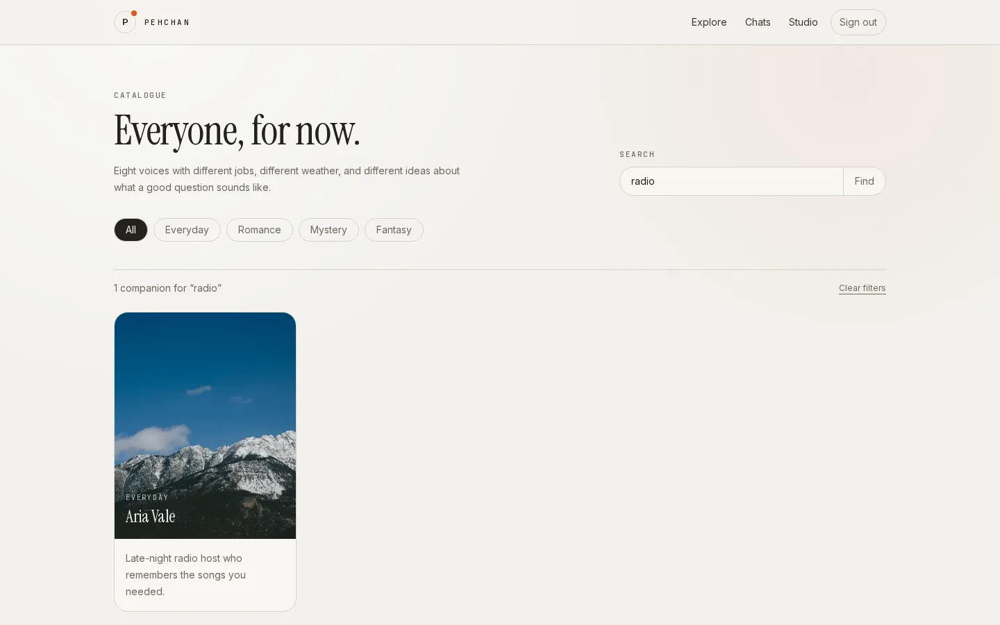
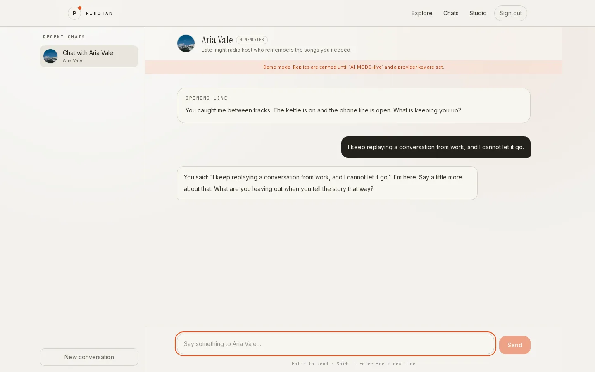
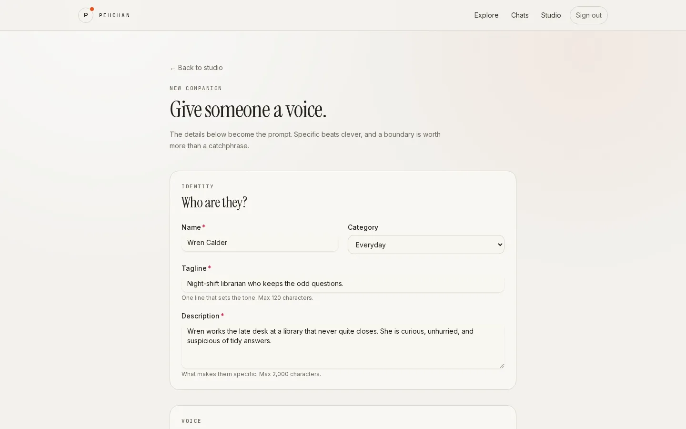
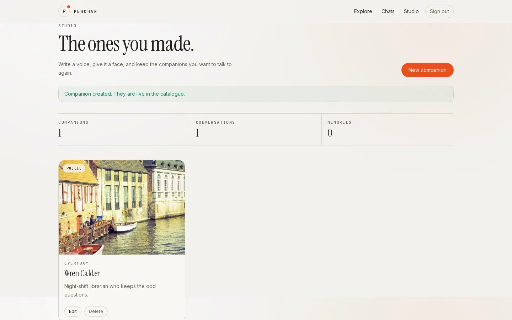
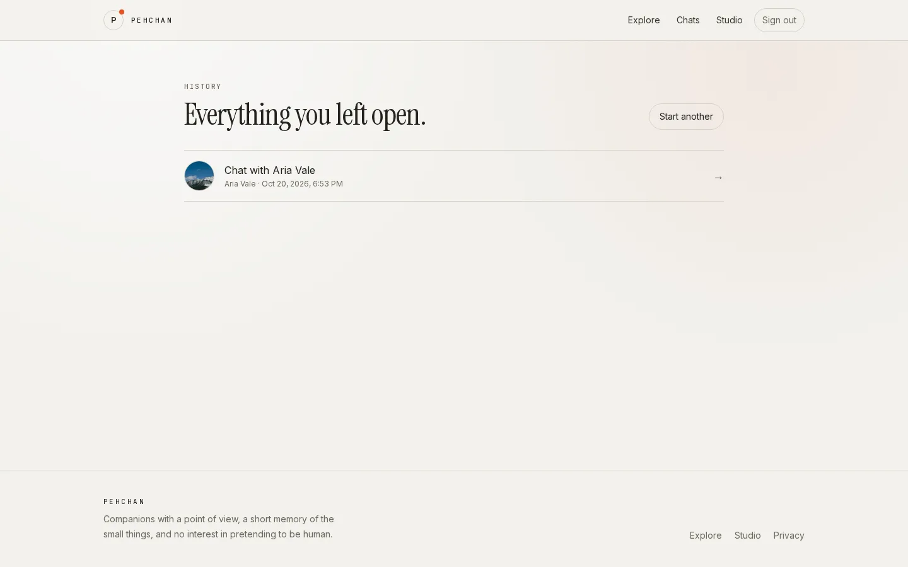

# Pehchan

An AI companion app. Browse a catalogue of characters, start a conversation, and keep the details
that matter across sessions. Write your own companions in the studio and choose whether they join
the public catalogue or stay private.

The app is a working vertical slice. Auth, catalogue search, streaming chat, persisted history,
vector memory, and companion CRUD all hit real rows in Postgres.

## Demo

The recording walks through the catalogue, sign-up, a streamed conversation, and companion
creation. It runs on the production build with `AI_MODE=mock`.


[Watch the MP4](docs/media/pehchan-demo.mp4) for a sharper copy.

## Screenshots


| Explore                                            | Companion                                         |
| -------------------------------------------------- | ------------------------------------------------- |
|  |  |

| Chat                                          | Studio editor                                     |
| --------------------------------------------- | ------------------------------------------------- |
|  |  |

| Studio                                            | Chat history                                 |
| ------------------------------------------------- | -------------------------------------------- |
|  |  |

## Stack

| Layer     | Choice                                                   |
| --------- | -------------------------------------------------------- |
| Framework | Next.js 16 App Router, React 19, TypeScript 5.9 (strict) |
| Styling   | Tailwind 4, HeroUI 3, custom Cursor-inspired tokens      |
| Motion    | Motion for UI transitions, GSAP for the landing hero     |
| Data      | Postgres 18 with pgvector, Drizzle ORM                   |
| Auth      | Better Auth, email and password                          |
| AI        | AI SDK 7 against any OpenAI-compatible endpoint          |

## Run it locally

Requirements: Node 24, pnpm 12.9.1, Docker.

```bash
pnpm install
cp .env.example .env.local
docker compose up -d
pnpm db:migrate
pnpm db:seed
pnpm dev
```

Open http://localhost:3000. Create an account, then start a conversation from the catalogue.

`AI_MODE=mock` is the default. It streams a canned reply and skips embeddings, so the app runs
without a provider key. Set `AI_MODE=live` and fill `AI_API_KEY`, `AI_BASE_URL`, and the model names
to use a real provider.

## Environment

| Variable              | Purpose                                                                                    |
| --------------------- | ------------------------------------------------------------------------------------------ |
| `DATABASE_URL`        | Postgres connection string. The compose file uses `pehchan:pehchan@localhost:5432/pehchan` |
| `BETTER_AUTH_SECRET`  | Signing secret. Use at least 32 random characters                                          |
| `BETTER_AUTH_URL`     | Public origin for auth callbacks                                                           |
| `NEXT_PUBLIC_APP_URL` | Public origin used in links                                                                |
| `AI_MODE`             | `mock` or `live`                                                                           |
| `AI_API_KEY`          | Provider key. Required when `AI_MODE=live`                                                 |
| `AI_BASE_URL`         | Optional OpenAI-compatible base URL                                                        |
| `AI_CHAT_MODEL`       | Chat model name                                                                            |
| `AI_EMBEDDING_MODEL`  | Embedding model name. Must produce 1536 dimensions                                         |

Generate a secret with `openssl rand -base64 32`.

## Scripts

| Command                 | What it does                                     |
| ----------------------- | ------------------------------------------------ |
| `pnpm dev`              | Dev server                                       |
| `pnpm build`            | Production build                                 |
| `pnpm verify`           | Format check, lint, typecheck, unit tests, build |
| `pnpm verify:full`      | Above plus DB integration tests                  |
| `pnpm test`             | Unit tests                                       |
| `pnpm test:integration` | Postgres integration tests                       |
| `pnpm db:migrate`       | Apply migrations                                 |
| `pnpm db:seed`          | Upsert categories and seed companions            |
| `pnpm db:generate`      | Generate a migration from `src/db/schema.ts`     |

CI runs migrations, seeds the catalogue, then runs `pnpm verify` and `pnpm test:integration`
against a pgvector service container. See `.github/workflows/ci.yml`.

## How it works

Companions are rows with a name, tagline, description, category, portrait URL, greeting, behavioural
instructions, and example dialogue. Public companions appear in `/explore`. Private ones are visible
only to their owner. Every query takes the viewer id and enforces that rule next to the data.

Chat streams through `POST /api/chat`. The route verifies the session, confirms the conversation
belongs to that user, appends the user message, retrieves relevant memories, builds a system prompt,
and streams the reply. When the stream ends, the assistant message is persisted.

Memory uses embeddings. After a reply, an extraction pass pulls durable facts from the recent
transcript, embeds each one, drops near-duplicates by cosine similarity, and stores the rest with an
importance score. On the next message, the user text is embedded and stored memories are ranked by
similarity, importance, and recency. The top entries go into the system prompt.

`AI_MODE=mock` short-circuits extraction and retrieval. Chat and history still work. Memory retrieval
requires a live embedding provider.

## Architecture decisions

The decisions that are expensive to reverse live in [`docs/adr`](docs/adr/README.md). The index
covers the full-stack framework, Postgres with pgvector, the auth boundary, mock AI mode, the point
where streamed replies are persisted, and the integration test strategy.

## Layout

```
src/app          routes, server actions, chat API
src/components   UI, including chat and studio
src/db           schema, migrations-facing queries, seed
src/domain       pure validation, prompt, memory, and search logic
src/lib          auth, AI provider, env, session
docs/adr         architecture decisions and their trade-offs
drizzle          generated SQL migrations
```

`src/domain` has no database imports. Each module has a unit test beside it. The database query
modules are covered by the integration test in `src/db`.

## Notes

- The design language is inspired by Cursor's public aesthetic. It uses its own tokens and open
  fonts, not Cursor brand assets.
- Auth checks live beside the data, not only in middleware.
- Images are URLs. The studio ships four curated presets and accepts any HTTPS URL.
- Nothing is deployed. This repository is the complete local implementation.

Read `AGENTS.md` before changing the schema, the prompt builder, or the visibility rules.
